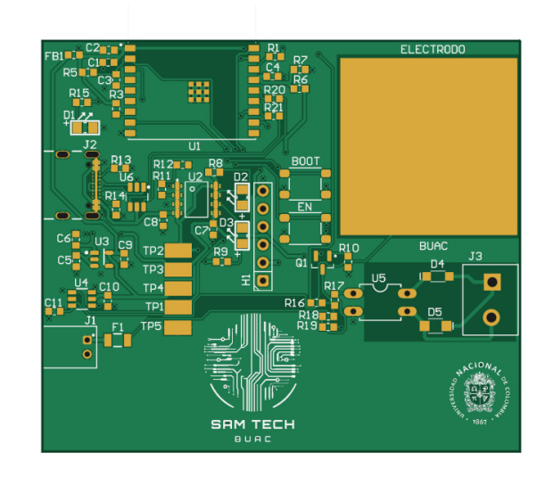

# BUAC – Botón Único de Aislamiento Capacitivo

Botón capacitivo sin contacto mecánico para abrir la puerta de un citófono Hikvision (entrada *Exit Button* / *Request to Exit*). Está pensado para adultos mayores y personas con movilidad reducida.



## Cómo funciona

1. La persona acerca la mano al electrodo de 25 × 25 mm, ubicado detrás de la tapa plástica.
2. El **TTP223** detecta el cambio de capacitancia y despierta al **ESP32-C3** del *Deep Sleep*.
3. El ESP32-C3 valida el toque durante 50 ms y activa el **PC817** durante 300 ms.
4. El PC817 cierra la entrada *Exit Button* del citófono con aislamiento galvánico, y la puerta se abre.
5. Un LED confirma la acción y el sistema vuelve a dormir.

## Hardware

| Bloque | Componente | Función |
|---|---|---|
| MCU | ESP32-C3-WROOM-02 | Control, Deep Sleep, USB nativo |
| Sensor | TTP223-BA6 | Detección capacitiva |
| Aislamiento | PC817 + Schottky + TVS 12 V | Salida aislada (5 kV rms) hacia el citófono |
| Carga | TP4056 (580 mA) | Carga de la Li-Po por USB-C |
| Regulación | RT9080-33 (Iq 2 µA) | Riel de 3,3 V |
| Protección | PTC de 750 mA + P-MOSFET | Cortocircuito y batería invertida |

## Especificaciones

| Parámetro | Valor |
|---|---|
| PCB | 67,5 × 58 mm, 2 capas, FR-4 1,6 mm, 1 oz |
| Alimentación | Li-Po 3,7 V 1000 mAh (con PCM), carga por USB-C |
| Consumo en reposo | ~19 µA (requisito ≤ 60 µA) |
| Aislamiento | PC817, 5 kV rms (requisito ≥ 1500 VAC) |
| DRC | 0 errores |

## Estructura del repositorio

```
docs/          Requisitos, arquitectura de firmware, nota de aplicación, pitch
hardware/      Proyecto de Altium, diagramas y archivos de fabricación
analysis/      Presupuesto de potencia y justificación técnica
images/        Renders y capturas
```

## Autoría

Proyecto académico de Diseño Electrónico, 2026.
